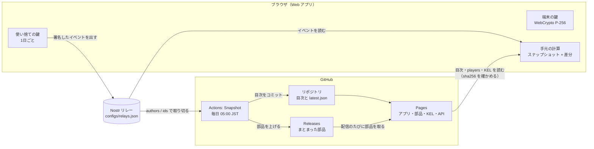
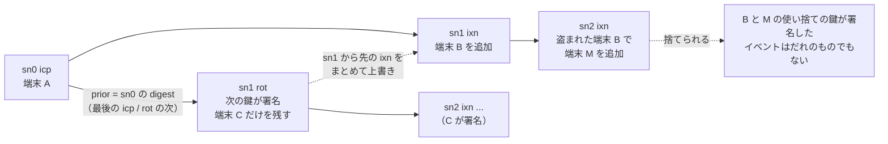
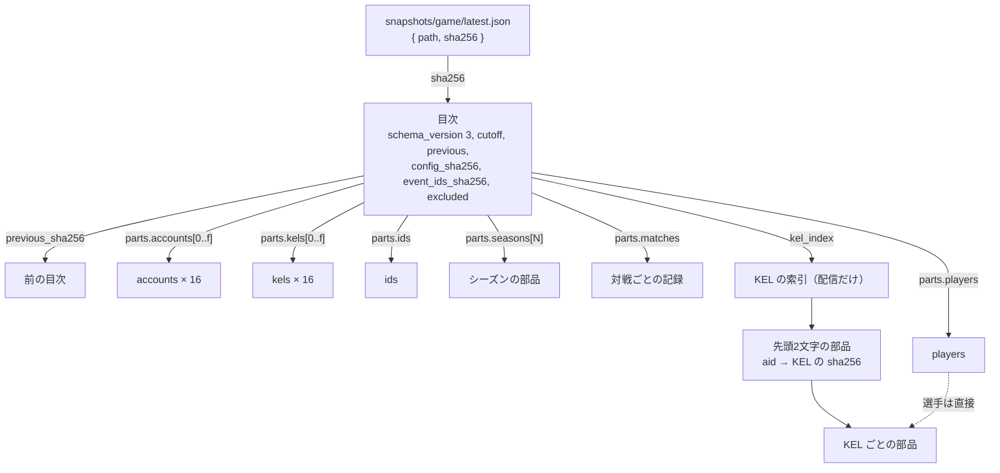
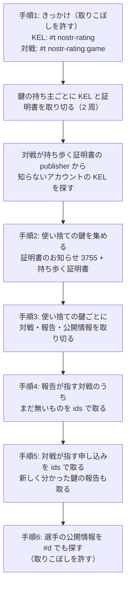
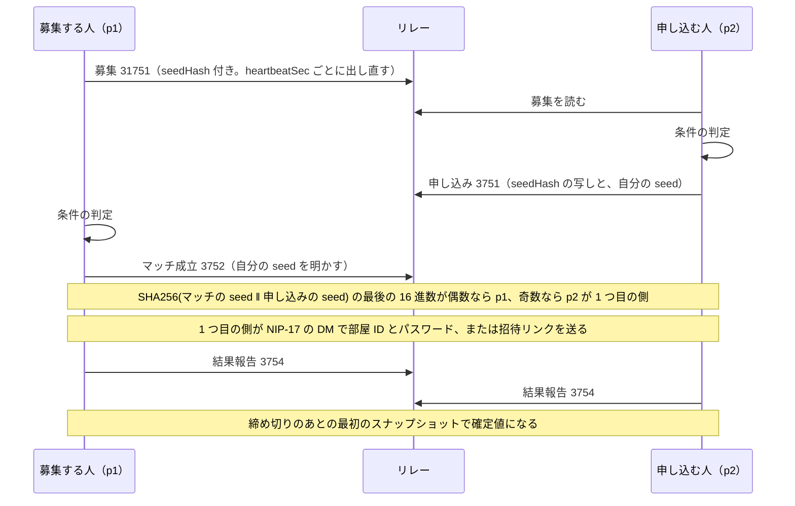
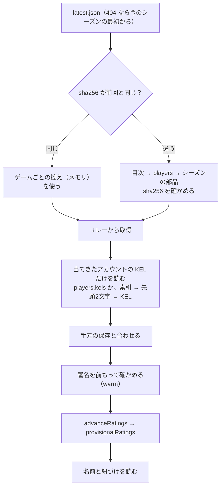

[English overview](spec.en.md)

# 内部設計仕様書

Nostr-Rating の仕組みと計算の決まり、それを実装するときの作りをまとめた文書です。

- 見出しに「決まり」とある節と、「この実装」と書いていない節は、クライアントとスナップショットの生成が同じイベントから同じ結果を出すための決まりです。別の実装もこれに従います。
- 「この実装」の節は、今のコード（`packages/core`、`apps/web`、`scripts/snapshot`）の作りと、計算量を抑える工夫です。結果を変えずに変えてよい部分です。
- 仕組み、計算、取得、同期、効率化に関わるコードを変えたときは、同じ PR でこの文書も直します（[CONTRIBUTING.md](../CONTRIBUTING.md)）。
- 式に出てくる記号は、式のすぐ下の表で定義します。

- ルールの値（ステージ、締め切り、Glicko-2 の値、連戦の重み、シーズンなど）はゲームごとの定義ファイル（[`configs/<game>.json`](../configs/)）を正とします。この文書に出てくる値は、断りがなければ `smash_sp` の例です。扱うゲームの一覧は [`configs/games.json`](../configs/games.json) です。
- 定義ファイルの表示の文字列（`name`、`notes`、`sides` など）は、文字列か言語ごとの文字列（`{"ja": "…", "en": "…"}`）です。イベントとスナップショットには入れず、表示するときに言語を選びます（[ADR 0017](adr/0017-localized-text.md)）。
- レート計算を変える変更は、すべてのクライアントとスナップショットの結果を変えます。シーズンの区切りで入れてください。
- 設計判断の理由は [`docs/adr/`](adr/) にあります。

以下、`<game>` は定義ファイルの `id`（`smash_sp`、`chess` など）です。アカウント（KEL、端末、使い捨ての鍵、公開情報）は全ゲームで共通で、レート、対戦設定、募集から結果報告までのイベント、スナップショットはゲームごとに分かれます（[ADR 0010](adr/0010-multiple-games.md)）。

## 全体の構成（この実装）

中央のサーバーは置きません。イベントは Nostr のリレーに置き、全員がそれぞれ同じ決まりで計算します。毎日の確定値（スナップショット）だけを GitHub Actions が作り、その計算は誰でも同じバイト列で作り直して確かめられます。



| 置き場所 | 持つもの | だれが書くか | 信用の根拠 |
|---|---|---|---|
| リレー | KEL、証明書のお知らせ、募集・申し込み・マッチ・報告・公開情報・DM | 利用者の端末 | イベントの署名と、KEL による本人の結び付け |
| リポジトリ | 目次（`snapshots/<game>/season_<N>/<日付>.json`）、`latest.json` | Actions | 履歴とハッシュのつながり、作り直しての照合 |
| Releases | `players`、`accounts`（16本）、`kels`（16本）、`ids`、シーズンの部品 | Actions | 目次の sha256 |
| Pages | アプリ、`snapshots/parts/<sha256>.json`、KEL の索引、公開 API、選手ページ、`api/v1/claims.json` | Actions（pages.yml） | 目次の sha256（公開 API は利便のための写し） |

## アカウント

アカウントは1つの鍵ではなく、鍵の出来事の記録（KEL）で表します。理由は [ADR 0008](adr/0008-key-event-log.md) にあります。

### 鍵の出来事（kind 3753）

content は `{"body": …, "sigs": […]}` です。タグは次のとおりです。

- `["t", "nostr-rating"]`、`["aid", "<aid>"]`、`["sn", "<番号>"]`
- `["x", "<aid>"]`: アカウントの KEL をまとめて探す手がかり。だれでも付けられるので、取りこぼしを許す用途にだけ使う
- `["n", "<次の鍵>"]`（`icp` と `rot` だけ）: 復活の言葉からアカウントを探す手がかり
- `["p", "<新しい端末の掲載用の鍵>"]`（端末を足す `ixn` と `rot`）: 登録を待っている端末に知らせる

| body.t | 中身 | 本文に署名する鍵 | Nostr のイベントに署名する鍵 |
|---|---|---|---|
| `icp`（作成の宣言） | `devices`、`next`（`keys`、`threshold`）、`nonce` | 載せた全端末 | 端末の掲載用の鍵 |
| `ixn`（端末の追加・取り消し・延長） | `aid`、`sn`、`prior`、`add`、`revoke`、`renew` | 有効な端末のどれか1つ | 端末の掲載用の鍵 |
| `rot`（入れ替え） | `aid`、`sn`、`prior`、`devices`、`next` | 今の `next.keys` のうち `threshold` 個 | 次の鍵 |

- 本文の digest はキーを辞書順に並べた空白のない JSON の SHA-256 です。aid は `icp` の digest です。`prior` は直前の本文の digest です。
- 端末の鍵は `{"type": "p256", "pub": <非圧縮の公開鍵>}`（WebCrypto の ECDSA P-256。署名は digest のバイト列への r‖s）か、`{"type": "schnorr", "pub": <公開鍵>}` です。schnorr の鍵はcontent に digest を入れた kind 23753 のイベント（タグなし）に署名し、その `created_at` と `sig` を本文の署名にします。次の鍵も同じ形で署名します。
- schnorr の端末が本文に署名するときは、その端末の登録にある掲載用の鍵（`publisher`）も、同じ digest に同じ形で署名します。`signer` は掲載用の鍵です。掲載用の鍵の署名がない schnorr の端末の署名は数えません。`publisher` が端末の鍵と同じ登録は受け付けません。P-256 の端末には要りません。理由は [ADR 0016](adr/0016-publisher-cosign.md) にあります。
- 端末の id は端末の鍵の digest の先頭 32 文字です。端末の登録には `expiresAt` があり、1回の登録・延長で `created_at` から 90 日を超えられません。
- 次の鍵は復活の言葉（BIP-39 の12語）から NIP-06 で作る鍵です。

KEL は次の決まりで評価します。

- イベントは `sn` と `prior` でつなぎます。`created_at` が直前のイベントより前のものは受け付けません。
- 同じ番号では `rot` が `ixn` を上書きできます。そのとき、その番号から先の `ixn` もまとめて捨てます。`rot` は `rot` を上書きできず、`ixn` は何も上書きできません。
- 上書きできない同じ番号のイベントは、先に見たほうを正とします。先に見た順はスナップショットの `kels` に記録した順、そのあとは `(created_at, id)` の順です。
- 次の鍵を空にした `rot`（端末も空）はアカウントの放棄です。以後のイベントは受け付けません。
- スナップショットに記録済みのアカウントへの新しいイベントは、`created_at` が「前回の cutoff − `report.deadlineSec`」より後のものだけを受け付けます。記録のないアカウントはすべてを受け付けます。
- アプリと復活の道具は、`created_at` が今より10分を超えて先の KEL のイベントを使いません。その上に新しいイベントを続けると、続けたイベントの `created_at` も先になり、スナップショットがその時刻まで受け付けないためです。
- 復活の言葉で入れ替える `rot` は最後の `icp` か `rot` の次に置き、そのあとの `ixn` をすべて上書きします。盗まれた端末で同じ番号の別の `ixn` を出されていても、どちらを先に見た人にも同じ `rot` が通ります。上書きした `ixn` で足した端末の使い捨ての鍵が署名したイベントは、だれのものでもなくなります。

KEL のつながりを式で書くと次のとおりです。

```math
\mathrm{digest}(b) = \mathrm{SHA256}(\mathrm{canonicalJSON}(b)), \qquad \mathrm{aid} = \mathrm{digest}(b_{\mathrm{icp}})
```

```math
b_k.\mathrm{sn} = k, \qquad b_k.\mathrm{prior} = \mathrm{digest}(b_{k-1}), \qquad t_k \ge t_{k-1} \qquad (k \ge 1)
```

| 記号 | 意味 |
|---|---|
| $`b`$ | KEL のイベント1件の本文（content の `body`。JSON のオブジェクト） |
| $`b_{\mathrm{icp}}`$ | 作成の宣言（`icp`）の本文。そのアカウントの番号0の本文 |
| $`k`$ | KEL の中の番号。`icp` が0で、1つずつ増える |
| $`b_k`$ | 番号 k の本文 |
| $`\mathrm{sn}`$ | 本文の項目。その本文の番号 |
| $`\mathrm{prior}`$ | 本文の項目。直前の本文の digest |
| $`t_k`$ | 本文 b<sub>k</sub> を載せた Nostr のイベントの `created_at`（UNIX 秒） |
| $`\mathrm{canonicalJSON}(b)`$ | b のキーを再帰的に辞書順に並べ、空白を入れずに書いた JSON の文字列 |
| $`\mathrm{SHA256}(x)`$ | 文字列 x（UTF-8）の SHA-256 を16進数の文字列にしたもの |
| $`\mathrm{digest}(b)`$ | 本文 b の digest。署名の対象になる値 |
| $`\mathrm{aid}`$ | アカウントの識別子 |

復活の言葉による `rot` の置き場所を図にすると次のとおりです。



この例では最後の確立イベントが sn0 の `icp` なので、`rot` は sn1 になり、sn1 と sn2 の `ixn` をまとめて捨てます。正規に足した端末 B も、`rot` の `devices` に入れなければ残りません。

スナップショットに記録済みのアカウントへの新しいイベントを受け付ける範囲は、次の式です。記録のないアカウントは $`t_{\mathrm{ev}} \le c_n`$ のすべてを受け付けます。

```math
c_{n-1} - D < t_{\mathrm{ev}} \le c_n
```

| 記号 | 意味 |
|---|---|
| $`t_{\mathrm{ev}}`$ | 受け付けるかを決める KEL のイベントの `created_at` |
| $`n`$ | スナップショットの番号。生成のたびに1つ進む |
| $`c_n`$ | 今回作るスナップショットの cutoff |
| $`c_{n-1}`$ | 前回のスナップショットの cutoff |
| $`D`$ | 報告の締め切りの長さ `report.deadlineSec` |

この範囲で KEL のイベントを選ぶのは、レート計算（`advanceRatings` と `provisionalRatings`）のときです。取得の KEL の一覧は今回の cutoff を上限にするだけで下限を絞らず、`Resolver` の KEL の一覧は上下とも絞りません（この実装）。

### 使い捨ての鍵と証明書

アプリのイベント（募集・申し込み・マッチ成立・結果報告・対戦設定・アカウントの公開情報）は、使い捨ての鍵が署名し、次のタグを持ちます。

- `["aid", "<aid>"]`
- `["cert", "<証明書の JSON>"]`。証明書は `{"cert": {v, aid, device, publisher, session, tip, from, until}, "sig": <本文の署名>, "publisherSig": <掲載用の鍵の署名>}` で、端末の鍵が `cert` の digest に署名します。`publisherSig` は schnorr の端末だけが付けます。

イベントがそのアカウントのものと認められるのは、次をすべて満たすときだけです。

- イベントの署名が正しく、イベントの `aid` タグが証明書の `aid` と同じ
- 証明書の `v` が 1
- イベントの署名者が `session` で、`created_at` が `from` 以上 `until` 以下
- `until` が `from` より後で、`until − from` が 86400 秒以下
- 証明書の署名の `signer` が `device` で、その端末の鍵で `cert` の digest への署名が正しい
- その端末の鍵が schnorr なら、`publisherSig` の `signer` が KEL に記録したその端末の掲載用の鍵で、その鍵で `cert` の digest への署名が正しい（証明書の `publisher` は使わない）
- `device` の端末が KEL の上で `from` の時点に有効（取り消しより前に始まった証明書は、取り消したあとも `until` まで有効）

認められないイベントはだれのものでもないとして無視します。端末の掲載用の鍵はその日の証明書を kind 3755（content は証明書の JSON、タグは `t` と `aid`）でも知らせます。

同じ条件を式で書くと次のとおりです。

```math
A(\mathit{ev}) = \mathit{cert}.\mathrm{aid} \quad \text{if all of:}
```

```math
\mathrm{ValidSig}(\mathit{ev}) \;\land\; \mathit{ev}.\mathrm{aidTag} = \mathit{cert}.\mathrm{aid} \;\land\; \mathit{cert}.v = 1 \;\land\; \mathit{ev}.\mathrm{pubkey} = \mathit{cert}.\mathrm{session}
```

```math
\mathit{cert}.\mathrm{from} \le \mathit{ev}.\mathrm{created\_at} \le \mathit{cert}.\mathrm{until} \;\land\; 0 < \mathit{cert}.\mathrm{until} - \mathit{cert}.\mathrm{from} \le 86400
```

```math
\mathit{sig}.\mathrm{signer} = \mathit{cert}.\mathrm{device} \;\land\; \mathrm{Verify}(\mathit{key}_{\mathrm{dev}}, \mathrm{digest}(\mathit{cert}), \mathit{sig}) \;\land\; \mathrm{Valid}(\mathit{cert}.\mathrm{device}, \mathit{cert}.\mathrm{from})
```

```math
\mathit{key}_{\mathrm{dev}} \text{ is P-256} \;\lor\; \bigl(\mathit{psig}.\mathrm{signer} = \mathit{pub}_{\mathrm{dev}} \;\land\; \mathrm{Verify}(\mathit{pub}_{\mathrm{dev}}, \mathrm{digest}(\mathit{cert}), \mathit{psig})\bigr)
```

満たさなければ $`A(\mathit{ev}) = \bot`$（だれのものでもない）です。

| 記号 | 意味 |
|---|---|
| $`\mathit{ev}`$ | アプリのイベント |
| $`A(\mathit{ev})`$ | ev を書いたと認めるアカウントの aid |
| $`\bot`$ | だれのものでもない（イベントを無視する） |
| $`\mathit{cert}`$ | ev の `cert` タグの証明書の本文（`v`、`aid`、`device`、`session`、`from`、`until` など） |
| $`\mathrm{ValidSig}(\mathit{ev})`$ | ev の Nostr の署名が正しく、id が中身のハッシュと合う |
| $`\mathit{ev}.\mathrm{aidTag}`$ | ev の `aid` タグの値 |
| $`\mathit{ev}.\mathrm{pubkey}, \mathit{ev}.\mathrm{created\_at}`$ | ev に署名した公開鍵と、ev の作成時刻 |
| $`\mathit{sig}`$ | 証明書の署名（`sig`）。`signer` は署名した端末の id |
| $`\mathit{key}_{\mathrm{dev}}`$ | cert.device の端末の鍵。cert.aid の KEL から引く |
| $`\mathit{psig}`$ | 証明書の掲載用の鍵の署名（`publisherSig`） |
| $`\mathit{pub}_{\mathrm{dev}}`$ | cert.device の端末の掲載用の鍵。cert.aid の KEL から引く |
| $`\mathrm{Verify}(K, x, y)`$ | 鍵 K で、値 x への署名 y が正しいか |
| $`\mathrm{Valid}(i, u)`$ | 端末 i が、KEL の上で時刻 u に有効か（有効な区間のどれかに u が入る） |
| $`\land`$ | かつ |

## イベント

独自の kind のイベントには必ず `["t", "nostr-rating"]` を付けます。アカウントの公開情報（全ゲームで共通）を除いて、`["t", "nostr-rating:<game>"]` と `["game", "<game>"]` も付けます。リレーは1文字のタグでしか絞り込めないので、ゲームごとに問い合わせるときは `t` タグを使います。content は JSON です。以下の「募集者」「p1」などはアカウント（aid）で、`p` タグには使い捨ての鍵を入れます。

| 用途 | kind | タグ | content |
|---|---|---|---|
| アカウントの公開情報 | 30756 | `["d", "<aid>"]` | `name`（表示名）、`claims`（下の「外部アカウントの紐づけ」） |
| 対戦設定 | 30078 | `["d", "nostr-rating:<game>:settings"]` | `stageBans`、`rangeChoice`、`rematchHours` |
| 募集 | 31751 | `["d", "<game>"]`、`["expiration", "<秒>"]`（NIP-40） | `firstFighter`、`rating`、`rangeChoice`、`rematchHours`、`settingsId`、`waitingSince`、`status`（`open` / `closed`）、`seedHash` |
| 申し込み | 3751 | `["a", "31751:<募集の使い捨ての鍵>:<game>"]`、`["p", "<募集の使い捨ての鍵>"]` | `recruiter`（募集者の aid）、`firstFighter`、`settingsId`、`rangeChoice`、`rematchHours`、`waitingSince`、`seedHash`、`seed` |
| マッチ成立 | 3752 | `["e", "<申し込みの id>"]`、`["p", "<双方の使い捨ての鍵>"]` | `p1`、`p2`、`p1Fighter`、`p2Fighter`、`p1SettingsId`、`p2SettingsId`、`seed` |
| 結果報告 | 3754 | `["e", "<マッチの id>"]`、`["p", "<相手の使い捨ての鍵>"]` | `result`（`win` / `lose` / `draw` / `cancel`） |
| 部屋 ID・連絡 | 1059（NIP-17） | `["p", "<宛先の使い捨ての鍵>"]` | 下の「対戦ルームの連絡」 |

- マッチ成立は p1（募集した側）のアカウントが署名します。content の `p1` は署名したアカウントと同じで、`p` タグに署名した使い捨ての鍵を含めなければなりません。
- アカウントの公開情報の `d` は署名したアカウントと同じでなければなりません。
- `seedHash` と `seed` は先後を決める乱数です（下の「先後」）。`seed` は32バイトの乱数を小文字の16進数64文字で書いたもの、`seedHash` は `seed` の SHA-256 です。申し込みの `seedHash` は申し込んだ募集の `seedHash` の写しです。
- `firstFighter`、`p1Fighter`、`p2Fighter` は、定義に `characters` があるゲームでだけ使います。ないゲームでは空の文字列にします。
- 結果報告の `draw` は、定義の `results.draw` が `true` のゲームでだけ使えます。ほかのゲームでは `draw` の報告を無視します。
- 結果報告は置き換えのない通常のイベントです。送り直すたびに新しいイベントを出し、前の報告も残ります。
- 署名の正しくないイベントと、形の合わないイベントは無視します。重複は署名を確かめたあとに id で除きます。

### 外部アカウントの紐づけ

`claims` の要素は `{platform, identity, proof}` です。検証用の文は `Verifying my Nostr-Rating account: <aid>` です。

| platform | identity | proof | 確かめ方 |
|---|---|---|---|
| `github` | ユーザー名 | Gist の id | Gist の所有者と本文を確かめる |
| `twitter` | ユーザー名（X） | 投稿の id | oEmbed（`https://publish.x.com/oembed`）で、投稿者のユーザー名と本文を確かめる |

形式に合わない identity と proof を持つ主張は無視します。X のユーザー名を変えると、oEmbed は新しい名前を返すので、新しい名前で確かめ直します。

### 対戦ルームの連絡

対戦の場所の受け渡しとチャットは NIP-17（rumor は kind 14、seal は kind 13）で送ります。
rumor には `["p", "<相手の使い捨ての鍵>"]` と `["e", "<マッチの id>"]` を付け、content は次のどれかです。

- `{"type": "room", "roomId": "…", "password": "…"}`（定義の `room.kind` が `code` のゲーム）
- `{"type": "link", "url": "https://…"}`（`room.kind` が `link` のゲーム。`https://` で始まり、500文字以下のものだけを受け付ける）
- `{"type": "chat", "text": "…"}`

`room` と `link` は1つ目の側（下の「先後」）の人からのものだけを受け付けます。招待リンクは対戦相手が送るものなので、クライアントはリンク先のホスト名を見せてから開きます。

送信者は自分宛てにも控えを包みます。受け取った側は、送信者がそのマッチの `p` タグの使い捨ての鍵であることを確かめます。

### 先後

定義の `sides` は2つの側の表示名です（スマブラSP は `P1`・`P2`、チェスは `白`・`黒`、英語では `White`・`Black`）。イベントには側の名前を入れず、どちらの人が1つ目の側かだけを決めます。1つ目の側の人が部屋を立てるか招待リンクを送ります。先後は双方の乱数で決めます（[ADR 0013](adr/0013-seat-draw.md)）。

1. 募集した側は乱数を作り、そのハッシュを募集の `seedHash` に載せます。乱数そのものはまだ出しません。
2. 申し込んだ側は募集の `seedHash` を申し込みに写し、自分の乱数を申し込みの `seed` に載せます。
3. 募集した側はマッチ成立の `seed` で自分の乱数を明かします。

どちらも相手の乱数を知る前に自分の乱数を決めるので、片方だけでは先後を選べません。明かした乱数のハッシュが申し込みの `seedHash` と合わない対戦は、有効な対戦になりません（下の「有効な対戦」）。

```math
h = \mathrm{SHA256}(m.\mathrm{seed} \,\|\, a.\mathrm{seed}), \qquad \text{p1 が1つ目の側} \iff \mathrm{last}(h) \bmod 2 = 0
```

| 記号 | 意味 |
|---|---|
| $`m.\mathrm{seed}`$ | マッチ成立の `seed`（募集した側の乱数） |
| $`a.\mathrm{seed}`$ | マッチが指す申し込みの `seed`（申し込んだ側の乱数） |
| $`x \,\|\, y`$ | 文字列 x と y をつないだもの |
| $`\mathrm{SHA256}(x)`$ | 文字列 x（UTF-8）の SHA-256 を16進数の文字列にしたもの |
| $`\mathrm{last}(h)`$ | h の最後の1文字を16進数として読んだ値 |
| $`\bmod`$ | 割った余り |

募集した側はマッチ成立を出す前に先後を知ります。都合が悪ければマッチ成立を出さずにやめることはできますが、その申し込みの相手を逃します（ADR 0013）。

## 有効な対戦

マッチ成立のイベントは次をすべて満たすときだけ有効です。

- 参照する申し込みが存在し、p2 のアカウントが署名している
- 申し込みの `recruiter` が p1 である
- 申し込みの `firstFighter` と `settingsId` がマッチの `p2Fighter` と `p2SettingsId` に一致する
- マッチの `seed` の SHA-256 が申し込みの `seedHash` に一致する
- マッチの `created_at` が申し込みの `created_at` 以上で、その差が `matching.applicationTimeoutSec` 以下である
- マッチの `created_at` がそのシーズンの開始以上で、終わりより前である

1つの申し込みに有効なマッチが複数あるときは、1つだけを使います。p2 が報告したマッチがあればそれを使い、それでも複数あれば id が最小のものを使います。マッチを出すのは p1 だけなので、p1 が出し直したマッチで結果を差し替えることはできません。

同じ条件を式で書くと次のとおりです。

```math
A(a) = m.\mathrm{p2} \;\land\; a.\mathrm{recruiter} = m.\mathrm{p1} = A(m) \;\land\; a.\mathrm{firstFighter} = m.\mathrm{p2Fighter} \;\land\; a.\mathrm{settingsId} = m.\mathrm{p2SettingsId}
```

```math
\mathrm{SHA256}(m.\mathrm{seed}) = a.\mathrm{seedHash}
```

```math
0 \le t_m - t_a \le T_{\mathrm{app}}, \qquad s_{\mathrm{start}} \le t_m < s_{\mathrm{end}}
```

| 記号 | 意味 |
|---|---|
| $`m`$ | マッチ成立のイベント（kind 3752） |
| $`a`$ | m が `e` タグで指す申し込み（kind 3751） |
| $`A(\cdot)`$ | イベントを書いたアカウント（「使い捨ての鍵と証明書」の式） |
| $`m.\mathrm{p1}, m.\mathrm{p2}`$ | m の content の、募集した側と申し込んだ側の aid |
| $`a.\mathrm{recruiter}, a.\mathrm{firstFighter}, a.\mathrm{settingsId}`$ | a の content の項目 |
| $`m.\mathrm{p2Fighter}, m.\mathrm{p2SettingsId}, m.\mathrm{seed}`$ | m の content の項目 |
| $`a.\mathrm{seedHash}`$ | a の content の項目（申し込んだ募集の `seedHash` の写し） |
| $`\mathrm{SHA256}(x)`$ | 文字列 x（UTF-8）の SHA-256 を16進数の文字列にしたもの |
| $`t_m, t_a`$ | m と a の `created_at` |
| $`T_{\mathrm{app}}`$ | `matching.applicationTimeoutSec` |
| $`s_{\mathrm{start}}, s_{\mathrm{end}}`$ | そのシーズンの始まりと終わりの時刻 |

「p2 が報告したマッチ」の報告は、時刻の範囲を問いません。

## 結果の確定

対戦の締め切りはマッチの `created_at` + `report.deadlineSec` と、マッチの `created_at` が入るシーズンの終わりの、早いほうです。

1. 当事者（p1 と p2）の報告のうち、`created_at` がマッチの作成時刻から締め切りまでのものを使います。
2. `win`・`lose`・`draw` のどれかを報告した人の `cancel` は、時刻を問わず使いません。引き分けのないゲームの `draw` は 1. で除くので、ここでも報告したことにしません。理由は [ADR 0015](adr/0015-cancel-after-result.md) にあります。
3. 報告を `(created_at, id)` の昇順に見て、噛み合う組が初めてそろった時点で確定します。噛み合う組とは「一方の `win` と他方の `lose`」、「双方の `draw`」（引き分けのあるゲームだけ）、または「双方の `cancel`」です。組はその時点の最新の報告どうしではなく、それまでに出したすべての報告で判定します。
4. 締め切りまでに組がそろわなければ、各自に報告があるかどうかで判定します。報告の中身は使いません。

締め切りと、確定に使う報告を式で書くと次のとおりです。

```math
T_d = \min(t_m + D,\; s_{\mathrm{end}}), \qquad R_m = \{\, r \mid \mathrm{target}(r) = m,\; A(r) \in \{m.\mathrm{p1}, m.\mathrm{p2}\},\; t_m \le t_r \le T_d \,\}
```

| 記号 | 意味 |
|---|---|
| $`m, t_m`$ | マッチ成立のイベントと、その `created_at` |
| $`D`$ | `report.deadlineSec` |
| $`s_{\mathrm{end}}`$ | $`t_m`$ が入るシーズンの終わりの時刻 |
| $`T_d`$ | m の締め切りの時刻 |
| $`r`$ | 結果報告のイベント（kind 3754） |
| $`\mathrm{target}(r)`$ | r の `e` タグが指すマッチ |
| $`A(r)`$ | r を書いたアカウント |
| $`t_r`$ | r の `created_at` |
| $`R_m`$ | m の確定に使う報告の集合 |

| 締め切り時点 | 結果 | マナーの目安 |
|---|---|---|
| 勝ちと負けの組がそろった | 確定 | 数えない |
| 引き分けの組がそろった | 引き分けで確定 | 数えない |
| 中止の組がそろった | 中止 | 双方の「中止」に +1 |
| 双方が報告したが組がない | 食い違い | 双方の「食い違い」に +1 |
| 片方だけが報告した | 未報告 | 報告しなかった側の「未報告」に +1 |
| どちらも報告しなかった | 未報告 | 数えない |

## レート計算

計算はスナップショットの状態に、イベントを加えて進めます。

- 締め切りが `(前回の cutoff, 今回の cutoff]` に入る有効な対戦を、マッチの `(created_at, id)` の昇順に1件ずつ評価します。各対戦は1回だけ評価します。
- `claims` が1つ以上あるアカウントの公開情報が一度でも見えたアカウントを「紐づけあり」とし、以後は外しません。見えたとみなすのは、`created_at` が今回の cutoff 以前の公開情報だけです。cutoff より後に出した紐づけは次の回から数えます。生成した時刻で結果が変わらないようにするためです。確定した対戦は、双方が紐づけありのときだけレートに入れます。
- 各対戦はその2人にとっての1つの rating period として Glicko-2 で更新します。時刻 t はマッチの `created_at` です。
  1. 前回の対戦からの経過 `floor((t - 前回の t) / rating.inactivityPeriodSec)` 期間分、RD を広げます（`rating.initialRd` で頭打ち）。
  2. 相手の更新前の値を使って、勝者と敗者を更新します。スコアは勝者が 1、敗者が 0、引き分けは双方 0.5 です。
  3. 同じ2人が、時刻の差が `rematchWeight.windowSec` 未満の間にレートに入れた対戦の数を h とし、`weights[min(h, 末尾)]` の重み w で、rating・RD・volatility をそれぞれ `更新前 + w × (更新後 − 更新前)` にします。
- 値は、RD を広げたとき、Glicko-2 で更新したとき、重みをかけたときに、それぞれ小数第6位で丸めます。
- 確定しなかった対戦は上の表のとおりマナーの目安だけを加えます。

### レート計算の式

計算は前の状態にイベントを足して進めます。

```math
S_n = \mathrm{Advance}(S_{n-1},\, I,\, c_n), \qquad S = (\mathrm{season}, \mathrm{cutoff}, \mathrm{players}, \mathrm{recentPairs}, \mathrm{kels}, \mathrm{accounts}, \mathrm{seasonSummaries})
```

| 記号 | 意味 |
|---|---|
| $`S_n`$ | n 番目のスナップショットの状態 |
| $`S_{n-1}`$ | 前回の状態（スナップショットが無ければ、シーズンの初期状態） |
| $`c_n`$ | 今回の cutoff |
| $`I`$ | 取得したイベントの集合。重複や、署名・形の正しくないものを含みうる |
| $`\mathrm{Advance}`$ | レート計算の関数（`advanceRatings`）。I の並び順に依存しない |
| $`\mathrm{players}`$ | aid → 選手の状態（rating、RD、σ、勝敗、マナーの回数、最後の対戦の時刻、紐づけの有無） |
| $`\mathrm{recentPairs}`$ | 直近にレートに入れた対戦（2人の組と時刻） |
| $`\mathrm{kels}, \mathrm{accounts}`$ | aid → 採用した KEL、aid → 最新の公開情報 |
| $`\mathrm{seasonSummaries}`$ | 終わったシーズンの成績 |
| $`\mathrm{season}, \mathrm{cutoff}`$ | その状態のシーズンの id と cutoff（S<sub>n</sub> では c<sub>n</sub>） |

1対戦の更新は次の3つの手順です。対戦は自分と相手 j の2人にとっての1つの rating period で、時刻 t はマッチの `created_at` です。

**手順1: 休んでいた分だけ RD を広げる**

```math
q = \left\lfloor \frac{t - t_{\mathrm{last}}}{P} \right\rfloor, \qquad \varphi = \frac{\mathrm{RD}}{C}, \qquad \mathrm{RD} \leftarrow \min\!\left( C \sqrt{\varphi^2 + \sigma^2 q},\; \mathrm{RD}_0 \right)
```

| 記号 | 意味 |
|---|---|
| $`t`$ | この対戦のマッチの `created_at` |
| $`t_{\mathrm{last}}`$ | その選手の前回の対戦のマッチの `created_at`（初めての対戦なら q = 0） |
| $`P`$ | `rating.inactivityPeriodSec` |
| $`q`$ | 休んでいた期間の数 |
| $`\lfloor x \rfloor`$ | x 以下の最大の整数 |
| $`\mathrm{RD}, \sigma`$ | その選手の rating deviation と volatility |
| $`C`$ | Glicko-2 の尺度の換算の値 173.7178 |
| $`\varphi`$ | Glicko-2 の尺度の RD |
| $`\mathrm{RD}_0`$ | `rating.initialRd`。広げても、これを超えない |
| $`\min(x, y)`$ | x と y の小さいほう |
| $`x \leftarrow y`$ | x の値を y に置き換える |

**手順2: Glicko-2 で更新する**

相手の値は、手順1で RD を広げたあと、手順2で更新する前のものを使います。

```math
\mu = \frac{r - r_0}{C}, \qquad \varphi = \frac{\mathrm{RD}}{C}, \qquad g(\varphi) = \frac{1}{\sqrt{1 + 3\varphi^2/\pi^2}}
```

```math
E = \frac{1}{1 + \exp\!\left(-g(\varphi_j)(\mu - \mu_j)\right)}, \qquad v = \left[ g(\varphi_j)^2 E (1 - E) \right]^{-1}, \qquad \Delta = v\, g(\varphi_j)(s - E)
```

```math
f(x) = \frac{e^x(\Delta^2 - \varphi^2 - v - e^x)}{2(\varphi^2 + v + e^x)^2} - \frac{x - \ln \sigma^2}{\tau^2}, \qquad f(x^*) = 0, \qquad \sigma' = e^{x^*/2}
```

```math
\varphi^* = \sqrt{\varphi^2 + \sigma'^2}, \qquad \varphi' = \left( \frac{1}{\varphi^{*2}} + \frac{1}{v} \right)^{-1/2}, \qquad \mu' = \mu + \varphi'^2 g(\varphi_j)(s - E)
```

```math
r' = C\mu' + r_0, \qquad \mathrm{RD}' = C\varphi'
```

| 記号 | 意味 |
|---|---|
| $`r, \mathrm{RD}, \sigma`$ | 自分の rating、rating deviation、volatility（手順1のあとの値） |
| $`j`$ | 相手。μ<sub>j</sub>、φ<sub>j</sub> は相手の値 |
| $`r_0, C`$ | 尺度の基準 1500 と、換算の値 173.7178 |
| $`\mu, \varphi`$ | Glicko-2 の尺度の rating と RD |
| $`s`$ | 自分のスコア。勝ち 1、負け 0、引き分け 0.5 |
| $`g(\varphi)`$ | 相手の不確かさで差を割り引く係数 |
| $`E`$ | 自分の期待スコア |
| $`v`$ | この対戦から推定したレートの分散 |
| $`\Delta`$ | 推定したレートの変化の大きさ |
| $`\tau`$ | `rating.tau`。volatility が変わる速さを抑える |
| $`f(x)`$ | 新しい volatility を求める方程式。x は ln σ′<sup>2</sup> の候補 |
| $`x^*`$ | f(x) = 0 の解。Illinois 法（regula falsi の変形）で、端の差が 10<sup>−6</sup> 以下になるまで求める |
| $`e, \exp, \ln, \pi`$ | ネイピア数、指数関数、自然対数、円周率 |
| $`\sigma'`$ | 新しい volatility |
| $`\varphi^*`$ | volatility の分だけ広げた RD（Glicko-2 の尺度） |
| $`\varphi', \mu'`$ | 新しい RD と rating（Glicko-2 の尺度） |
| $`r', \mathrm{RD}'`$ | 新しい rating と RD |

**手順3: 連戦の重みで縮める**

```math
h = \left| \{\, z \in Z \mid \mathrm{pair}(z) = \{\text{self}, j\},\; t - t_z < W \,\} \right|, \qquad w = \mathrm{weights}[\min(h, L - 1)]
```

```math
y \leftarrow \mathrm{round6}\big(y + w\,(y' - y)\big) \qquad (y \in \{r, \mathrm{RD}, \sigma\})
```

| 記号 | 意味 |
|---|---|
| $`Z`$ | これまでにレートに入れた対戦（双方が紐づけありで、勝ち負けか引き分けで確定したもの）の記録（recentPairs） |
| $`z`$ | Z の中の1件 |
| $`\mathrm{pair}(z)`$ | z で対戦した2人の aid の組 |
| $`\text{self}, j`$ | 今回の対戦の2人（自分と相手） |
| $`t_z`$ | z のマッチの `created_at` |
| $`W`$ | `rematchWeight.windowSec` |
| $`h`$ | 今回より前に、W 以内に同じ2人でレートに入れた対戦の数 |
| $`\mathrm{weights}`$ | `rematchWeight.weights`。添字は0から |
| $`L`$ | weights の長さ |
| $`w`$ | 今回の更新にかける重み |
| $`y`$ | 手順2の前の値（手順1のあと） |
| $`y'`$ | 手順2で計算した更新後の値 |
| $`\mathrm{round6}(x)`$ | x を小数第6位に丸めた値（`Math.round(x·10^6) / 10^6`） |
| $`\lvert X \rvert`$ | 集合 X の要素の数 |

- 丸め（round6）は、手順1、手順2、手順3のそれぞれで、rating・RD・σ のすべてにかけます。
- recentPairs は、W とマッチングの `rematchHours` の最大の長いほうの間だけ残します。
- 例: 初期値（1500、350、0.06、τ = 0.5）どうしの1戦目は、勝った人が rating 1662.310894、負けた人が 1337.689106、どちらも RD 290.318964 になります（`packages/core/test/rating/pipeline.test.ts` の最初のテスト）。

クライアントは締め切り前でもすでに確定した対戦を、暫定値として上乗せして表示してよいです。確定した結果は覆らないので、ふつうは締め切り後の計算と一致します。ただし、先に作られた対戦の報告があとからそろうと、計算の順番が変わり、値が少しずれることがあります。

## シーズン

シーズンは `seasons` の起点（`firstStartsAt`）から、`months` か月ごとに区切ります。月は `utcOffsetMinutes` の時差での暦の月で数え、id は 1 から順に振ります。一覧ではないので、誰も更新しなくてもシーズンは続きます。

- 対戦は、マッチの `created_at` が入るシーズンで数えます。締め切りはシーズンの終わりで切るので（「結果の確定」）、シーズンの終わりまでに組がそろわなかった対戦は、ほかの対戦と同じく未報告か食い違いになります。
- シーズンの終わりの直前でも、新しい対戦を始められます（[ADR 0012](adr/0012-season-end-deadline.md)）。クライアントは、締め切りがシーズンの終わりで切られる対戦では、そのことを対戦ルームに出します。
- 新しいシーズンは全員が初期値から始まります。前のシーズンの成績は最終スナップショットのシーズンの部品に残ります。
- クライアントは、手元のスナップショットが前のシーズンのものなら、今のシーズンを初期値から始め、シーズンの成績だけを引き継ぎます。

## スナップショット

スナップショットは目次と部品に分けます（[ADR 0011](adr/0011-scale.md)）。目次はゲームごとに `snapshots/<game>/season_<N>/<cutoff の JST の日付>.json` に置き、`snapshots/<game>/latest.json` がそのパスと sha256 を指します。KEL はゲームに依存しませんが、スナップショットをゲームごとに作り直せるよう、各ゲームのスナップショットにそれぞれ記録します。

- JSON はキーを再帰的に昇順に並べ、末尾に改行を1つ付けます。目次は2スペースで字下げし、部品は空白を入れません。誰が生成しても同じバイト列になります。
- 目次の主な項目は次のとおりです。
  - `schema_version`: 3
  - `cutoff`: この時刻までに締め切りを迎えた対戦を処理済み
  - `previous`、`previous_sha256`: 前の目次
  - `config_sha256`: レート計算に関わる設定値のハッシュ
  - `inputs.event_ids_sha256`: 使ったイベントの id を昇順に `\n` でつないだ文字列の sha256
  - `excluded`: 取り切れなかったアカウント。この回は報告と公開情報を使わず、対戦を相手の報告に合わせて確定した（下の「取得」）
  - `parts`: 部品ごとの `sha256`、`size`（バイト数）、`release`（部品を置いたリリースのタグ）。`accounts` と `kels` は aid の先頭1文字ごとに分けた部品で、先頭1文字 → 部品の形です
  - `kel_index`: KEL の索引の `sha256` と `size`
- `parts` の部品はリリースに `<sha256>.json` の名前で置きます。前の回と同じ部品は上げ直さず、目次はその部品を最初に置いたリリースを指します。
  - `players`: アカウント（aid）ごとの状態（`players`）、連戦の判定に使う直近の確定済みの対戦（`recent_pairs`）、選手の公開情報（`accounts`）、選手の KEL の部品の sha256（`kels`）
  - `accounts`: 全アカウントの最新の公開情報。1つの部品が大きくなりすぎないよう、aid の先頭1文字ごとに分けます
  - `kels`: アカウントごとに採用した KEL（`sn` の順）。全員の「先に見た版」になり、シーズンをまたいで引き継ぎます。`accounts` と同じく aid の先頭1文字ごとに分けます
  - `ids`: 使ったイベントの id（昇順）。対象は評価した対戦、その申し込み、その対戦を指す締め切りまでの報告（当事者かどうかと、作成時刻の下限は問わない）、初めて紐づけありにしたアカウントの公開情報（アカウントごとに `(created_at, id)` が最小のもの）、この回に更新した最新の公開情報、新しく採用した KEL のイベントです
  - `seasons.<シーズン id>`: 終わったシーズンに対戦したアカウントの最終レート・最高レート・対戦数・勝敗・引き分けの数（`summaries`）と、その時点の公開情報（`accounts`）。以後のスナップショットにも同じ部品を引き継ぎます
  - `matches`: この回に評価した対戦の記録（下の「対戦ごとの記録」）。この部品を作る前の目次には無い
- KEL の索引と KEL ごとの部品は `kels` の部品から作ります。KEL ごとの部品は1アカウントの KEL です。索引は aid の先頭2文字ごとの部品（aid → KEL の部品の sha256）と、その一覧（先頭2文字 → 部品の `sha256` と `size`）です。
- 配信には `snapshots/<game>/` の下に `latest.json` と目次を置き、部品は全ゲームで共通の `snapshots/parts/<sha256>.json` に置きます。名前が sha256 なので、同じ KEL を記録したゲームどうしでは1つにまとまります。部品は `players`、シーズンの部品、KEL の索引、KEL ごとの部品、`matches` で、`accounts` と `ids` は置きません。`matches` はクライアントは読まず、誰でも1つの対戦を確かめられるように置きます。読む側はどのファイルも sha256 を確かめてから使います。
- クライアントは新しいイベントに出てきたアカウントの KEL だけを読みます。そのアカウントが `players` の部品にあればその sha256 で、無ければ索引で引きます。`latest.json` が無いときは、今のシーズンの最初から計算します。
- `cutoff` は生成する時刻以前でなければなりません。シーズンの途中で `config_sha256` が変わるスナップショットは作りません。
- 前のスナップショットのシーズンが終わっていたら、まずそのシーズンの終わりまでを処理した最終スナップショット（`snapshots/<game>/season_<N>/final.json`、`kind` は `final`）だけを作ります。次のシーズンの最初のスナップショットは、その次の生成で作ります。レート計算に関わる設定は、この2つの間でだけ変えられます。

スナップショットのつながりを図にすると次のとおりです。



### 対戦ごとの記録

`matches` の部品は `{"matches": [...]}` で、この回に評価した対戦を、評価した順（マッチの `(created_at, id)` の昇順）に並べます。対象は使ったイベントの id（`ids`）に入れた対戦と同じです。理由は [ADR 0014](adr/0014-match-records.md) にあります。

| 項目 | 中身 |
|---|---|
| `id`、`created_at` | マッチ成立のイベントの id と `created_at` |
| `p1`、`p2` | 募集した側と申し込んだ側の aid |
| `result` | `p1`・`p2`（その側の勝ち）、`draw`、`cancel`、`mismatch`、`no_report` |
| `missing` | `result` が `no_report` のとき、報告しなかった側の aid（昇順）。それ以外は空 |
| `rating` | レートに入れた対戦だけ。`weight`（連戦の重み w）と、`p1`・`p2` それぞれの `before`（対戦の前の rating・RD・σ）、`periods`（手順1の q）、`after`（手順3のあとの値）。入れなかった対戦は `null` |

レートに入れた対戦は記録と定義だけで更新を計算し直せます（core の `recomputeRating`）。

```math
y^{(0)}_i = \mathrm{Inflate}(\mathit{before}_i, \mathit{periods}_i), \qquad \mathit{after}_i = \mathrm{Weight}\big(y^{(0)}_i,\; \mathrm{Glicko2}(y^{(0)}_i, y^{(0)}_j, s_i),\; w\big)
```

| 記号 | 意味 |
|---|---|
| $`i, j`$ | 記録の p1 と p2（i が一方なら j は他方） |
| $`\mathit{before}_i, \mathit{periods}_i, \mathit{after}_i`$ | 記録の `rating` の、i の側の項目 |
| $`\mathrm{Inflate}`$ | 「レート計算の式」の手順1（q = periods） |
| $`\mathrm{Glicko2}(y_i, y_j, s_i)`$ | 手順2。相手の値は手順1のあとのもの |
| $`\mathrm{Weight}`$ | 手順3（w = 記録の `weight`） |
| $`y^{(0)}_i`$ | 手順1のあとの i の値 |
| $`s_i`$ | i のスコア。`result` が i の側なら 1、相手の側なら 0、`draw` なら 0.5 |
| $`w`$ | 記録の `weight` |

- 同じシーズンの中で選手ごとに記録を並べると、前の対戦の `after` が次の対戦の `before` と同じになります。前の回までの対戦とつなぐには、その回の `matches` の部品も使います。シーズンが変わると全員が初期値から始まるので、前のシーズンの対戦とはつながりません。
- `weight` と `periods` は同じ2人の直近の記録と、その選手の前の対戦の `created_at` と照らして確かめます。1件の記録だけでは確かめられません。

リリースのタグと、使ったイベントの一覧のハッシュは次の式で決めます。

```math
\mathrm{tag}(p) = \texttt{snapshot-} + \mathrm{replace}(\mathrm{strip}(p), \texttt{/}, \texttt{-}), \qquad \mathrm{event\_ids\_sha256} = \mathrm{SHA256}(\mathrm{join}(\mathrm{sort}(\mathit{ids}), \texttt{LF}))
```

| 記号 | 意味 |
|---|---|
| $`p`$ | 目次のパス（例: `snapshots/smash_sp/season_1/2026-10-02.json`） |
| $`\mathrm{strip}(p)`$ | p から先頭の `snapshots/` と末尾の `.json` を除いたもの |
| $`\mathrm{replace}(x, /, -)`$ | x の中の / をすべて - にしたもの |
| $`\mathrm{tag}(p)`$ | 部品を置くリリースのタグ（例: `snapshot-smash_sp-season_1-2026-10-02`） |
| $`\mathit{ids}`$ | その回に使ったイベントの id の一覧 |
| $`\mathrm{sort}, \mathrm{join}, \texttt{LF}`$ | 昇順に並べる。改行（LF、`\n`）でつないで1つの文字列にする |

### 生成の手順（この実装）

`scripts/snapshot/src/run.ts` の `runSnapshot` は次の順に進めます。

1. `latest.json` → 目次 → 部品の順に読み、それぞれ sha256 を確かめる。部品は手元の `.snapshot-parts/` に無ければリリースから取る。
2. シーズンの途中で `config_sha256` が変わっていたら止める。
3. 前回の KEL を信じずに、全員分の署名を1回だけ確かめる（`warmKelSignatures` → `verifyRecorded`）。記録したとおりに評価できないアカウントがあれば止める。
4. イベントを「取得」の方法で取り切り（strict）、`advanceRatings` で進める。前回のシーズンが終わっていれば、終わりまでを処理した `final.json` だけを書いて終える（手順3と4も、この中で行う）。
5. `buildSnapshot` で部品を作る。前の目次と同じ sha256 の部品は前のリリースを指したまま上げ直さない。終わったシーズンの部品は前の目次からそのまま引き継ぐ。
6. 新しい部品を `upload/<タグ>/` に置き、目次と `latest.json` を書く。

ワークフロー（`.github/workflows/snapshot.yml`）は、部品をリリースに上げてから目次をコミットし、配信（`pages.yml`）を起動します。ゲームが1つ失敗しても、ほかのゲームは続け、書けたゲームの分を上げてコミットしてから、最後の段で失敗にします（`eachGame`）。

リポジトリでは Immutable releases を有効にしていて、公開したリリースには添付を足せません。そのため、リリースは下書きで作り、部品を添付してから公開します。同じ日にもう一度動かすと、目次のパスが同じなのでタグも同じになります。前の実行がリリースを公開したあと、目次を積めずに止まっていた場合は、次のように扱います。

- そのリリースに今回の部品がすべてそろっていれば、上げずに続けます。部品の名前は sha256 なので、名前がそろっていれば中身も同じです。
- 1つでも足りなければ、どのゲームの部品も上げず、目次もコミットせずに失敗にします。翌日の実行は新しいタグになるので、そこから続きます。
- 添付の途中で止まった下書きは、消して作り直します。

目次の `excluded` は記録ですが、作り直すときに入力として読むコードはありません。作り直した結果は、リレーが返す内容によっては目次と一致しないことがあります。

## 取得

スナップショットの生成とクライアントは、同じ方法でイベントを集めます。だれでも付けられるタグの問い合わせは、取りこぼしを起こさせる攻撃に弱いので、次のように分けます。

- 取り切る必要がある問い合わせは、`authors` か `ids` だけにします。KEL と証明書のお知らせは鍵の持ち主（掲載用の鍵と次の鍵）で、対戦・報告・公開情報は使い捨ての鍵で、申し込みは id で取ります。
- これらは複数のアカウントをまとめて投げます。1つの秒に1ページを超えるイベントがあって取り切れなければ、アカウントを半分に分けて投げ直します。1アカウントまで分けても取り切れないときだけ、そのアカウントを `excluded` にします。全体は止めません。
- 取れた分はリレーや問い合わせの順で変わるので、その回は `excluded` のアカウントの報告と公開情報を使いません。そのアカウントの対戦は相手の最新の報告に合わせたものとみなして確定します。相手の報告も「結果の確定」の 1. と 2. で選んだものだけを使います。相手が報告していない対戦と、双方が `excluded` の対戦は数えません。そのアカウントが出した対戦は、相手が報告したものだけを使います。
- KEL と証明書のお知らせを取り切れなかったアカウントは、その回は新しい KEL のイベントを使わず、スナップショットに記録済みの KEL で判定します。
- 報告が指す対戦のうち、まだ取れていないものは id で取ります。相手の分を取り切れなくても、報告した側から対戦を見つけるためです。
- `#t` の問い合わせは新しいアカウントとその対戦を見つけるきっかけにだけ使い、取りこぼしを許します。まだ知らないアカウントの KEL は、イベントが持ち歩く証明書の `publisher` から探します。
- スナップショットの生成ではそれぞれのリレーから EOSE まで受け取れた問い合わせだけを使います。時間切れになった問い合わせと、EOSE の前にリレーに閉じられた問い合わせ（rate-limited など）は合わせて3回まで試し、それでも取れなければそのゲームの生成をやめて何も書きません。ほかのゲームは続けます。次の生成でやり直します。
- 1回に返す件数の上限（NIP-11 の `max_limit`）が1ページの300件より少ないと公開しているリレーがあれば、生成を始めません。上限より短いページを、取り切ったページと見分けられないためです。
- クライアントは、つながらないリレーと時間切れの分を除き、届いた分で表示します。

### 取得の手順（この実装）

`packages/core/src/relay/fetch.ts` の `fetchRatingEvents` は、生成とクライアントで同じ手順を使います。時刻で絞る問い合わせは、「前回の cutoff − `report.deadlineSec` − 86400 秒」以降を取ります（86400 秒は証明書の長さの上限）。証明書から新しく見つけたアカウントの KEL と証明書は、作成が昔でも見つけるため、今回の cutoff を上限にするだけで下限を絞りません。`ids` で取る対戦と申し込みは、時刻で絞りません。`#d` で探す選手の公開情報は、今回の cutoff を上限にします。



取り切る問い合わせは、複数のアカウントの鍵を `authors` に合わせて100個まで並べて1回で投げます。リレーごとに `until` を古い方へずらしながら1ページ300件で取り切り、1つの秒に300件を超えるイベントがあってその秒を取り切れないと、アカウントを半分に分けて投げ直します。

```text
run(batch):
  try   return queryAll({…filter, authors: batch の鍵})   # リレーごとにページ送りし、最後に重複を除く
  catch Overflow:
    if batch のアカウントが 1 つ → excluded に入れて [] を返す
    left, right = batch を半分に
    return run(left) ++ run(right)
```

```math
Q(N, u) \approx \left\lceil \frac{KN}{B} \right\rceil + u \cdot 2 \left\lceil \log_2 (B / K) \right\rceil
```

| 記号 | 意味 |
|---|---|
| $`N`$ | まとめて問い合わせるアカウントの数 |
| $`u`$ | そのうち、1つの秒に1ページを超えるイベントを出したアカウント（攻撃者）の数 |
| $`K`$ | 1アカウントあたりの鍵の数 |
| $`B`$ | 1回の問い合わせの `authors` に並べる鍵の数の上限 `CHUNK`（100） |
| $`Q(N, u)`$ | リレー1つあたりの問い合わせの回数（各問い合わせの結果が1ページに収まるとき） |
| $`\lceil x \rceil, \log_2`$ | x 以上の最小の整数。2を底とする対数 |

- 攻撃者1人あたりの追加の問い合わせは、1回に入るアカウントの数の対数程度です（B = 100、K = 2 なら最大で約12回）。
- 同時に投げる問い合わせは、リレーごとに4本までです。
- 半分に分けるのは生成（strict）のときだけです。クライアントはその秒を飛ばして先へ進むので、その秒のイベントを何も知らせずに取りこぼします。
- 生成は、EOSE まで返さなかった問い合わせを合わせて3回まで試し、それでも駄目ならそのゲームは何も書かずに止めます（「取得」の決まり）。上限を NIP-11 で公開していないリレーは、警告に出します。
- 生成は毎日、記録済みの全アカウントの鍵ごとに KEL と証明書を問い合わせます。`#t` をあふれさせられても、既知のアカウントの対戦を取りこぼさないためです。

## マッチング

マッチの条件は、双方のクライアントがそれぞれ判定します。マッチは双方が受け入れて初めて成立するので、レート計算では条件を確かめません。

- **レート差:** 双方の `rangeChoice` のうち狭いほう。`null`（制限なし）は`matching.unlimitedStart` から待機1分ごとに `matching.unlimitedExpandPerMinute` ずつ広がります。
- **連戦:** 双方の `rematchHours` のうち長いほうの時間内に対戦した相手とは組みません。
- **マナーの目安:** 回数の合計の差が `matching.mannersMaxDiff` を超える相手とは組みません。
- **紐づけ:** 主張のない相手とは組みません。

レートとマナーの回数は、相手の自己申告ではなく、各クライアントが手元で計算した値を使います。

手順は次のとおりです。

1. 条件に合う他人の募集があれば申し込み、`matching.applicationTimeoutSec` の間、マッチ成立を待ちます。
2. なければ自分の募集を出し、`matching.heartbeatSec` ごとに出し直します。最初に条件を満たした申し込みに、マッチ成立を出します。
3. 一度募集を出したあとは、自分より先に待っていた（`waitingSince` が小さい。同じなら aid が小さい）相手にだけ申し込みます。互いに申し込み合うのを防ぐためです。
4. 申込者は自分の申し込みに応えた正当なマッチだけを受け取ります（上の「有効な対戦」の条件）。

対戦の流れを図にすると次のとおりです。



### マッチングの作り（この実装）

- 募集は5秒ごとに読みます（`SCAN_INTERVAL_SEC`）。1回の確認で申し込むのは最大3件です。
- 募集した側は、マッチを出す前に、申し込んだ相手について同じ条件を判定します。申し込みの `created_at` から `applicationTimeoutSec − 2` 秒未満で、`seedHash` が自分の今の募集と同じ申し込みだけを受けます。
- 先後の乱数は、1回の探索（`Matchmaker.search`）ごとに1つ作ります。明かすのはマッチ成立を出すときだけで、出すと探索が終わるので、明かした乱数を次の募集に使うことはありません。
- 申し込んだ側は、1回の探索の中で同じ `seedHash` の募集に申し込み直すときは、前と同じ乱数を使います。募集した側が申し込みに応えずに待っても、申し込み直しで先後は変わりません。
- 待っている人がそれぞれ全員の募集を読むので、リレーが返す量は待っている人数の2乗で増えます。リレーが1回に返す件数の上限を超えると、候補の一部が見えなくなります（README の「既知の限界」）。

## クライアントの同期（この実装）

`apps/web/src/services/sync.ts` の `syncRatings` と `AppContext` は次の順に進めます。同期はゲームごとに同時に1本だけ走らせ、走っている間に頼まれた分は終わったあとに1回だけやり直します。



```math
W_{\mathrm{client}} = \left[\, c_{\mathrm{snap}} - D - T_{\mathrm{cert}},\; \mathrm{now} \,\right], \qquad \mathrm{now} - c_{\mathrm{snap}} < 86400
```

| 記号 | 意味 |
|---|---|
| $`W_{\mathrm{client}}`$ | クライアントがリレーから取る範囲。この範囲のイベントに出てきたアカウントの KEL を読む |
| $`c_{\mathrm{snap}}`$ | クライアントが読んだスナップショットの cutoff |
| $`D`$ | `report.deadlineSec` |
| $`T_{\mathrm{cert}}`$ | 証明書の長さの上限（86400 秒） |
| $`\mathrm{now}`$ | 今の時刻 |

スナップショットは毎日作るので、W<sub>client</sub> の長さはおよそ2〜3日です。

- 手元の保存からは、対戦と報告を c<sub>snap</sub> − D 以降、申し込みをそれより `applicationTimeoutSec` 前から読みます。公開情報と KEL は、その範囲のイベントに出てくるアカウントの分だけを使います。
- KEL の部品は、そのシーズンの選手なら `players.kels[aid]` の sha256 から、そうでなければ索引 `kel_index` → 先頭2文字の部品 → KEL の部品の順に引きます。読んだ部品は覚え、失敗したものは覚えません。部品を取れなかったときは、同期の失敗にします。
- 前のシーズンの final がまだ無いときは、前のシーズンの最後のスナップショットの cutoff から新しいシーズンを始めます。
- 他人のイベントの書き手は `Resolver` が結び付けます。知らないアカウントはまとめて、スナップショットから1回、リレーから100件ずつ探します（`authorAll`）。問い合わせが例外になったときは「探した」ことにしません。見つからなかったアカウントは60秒たってから探し直します。
- 名前と紐づけは、スナップショットに公開情報がある選手なら c<sub>snap</sub> − D 以降の版だけをリレーに聞きます。問い合わせは4本ずつ並べます。

## 効率化の仕組み（この実装）

どれもレートの結果を変えません。

| 仕組み | 何を減らすか | 実装 |
|---|---|---|
| 署名の結果の控え | 同じ署名の確かめ直し。KEL は（鍵、digest、署名）、イベントは（id、pubkey、署名）をキーに結果を覚える。イベントは毎回、id が中身のハッシュと合うかだけを確かめる。クライアントは5万件まで、生成は上限なし | `kel.ts`、`kinds.ts`、`setVerifyCacheLimit` |
| 速い検証 | P-256 は WebCrypto、Nostr のイベントは nostr-wasm で確かめる。nostr-wasm に渡す前に、id・鍵・署名の形を確かめる（渡した長さしか読まないため） | `fast.ts`、`warm.ts` |
| 前もって確かめる | KEL の評価は同期処理なので、使う前に非同期の WebCrypto で並べて確かめ、控えに入れる | `warmKelSignatures` |
| KEL の遅い評価 | アカウントごとに使うときに初めて評価し、イベントが増えたアカウントだけを評価し直す | `KelBook` |
| 問い合わせをまとめる | `authors` に100個まで並べ、あふれたときだけ分ける。リレーごとに4本並べる | `perAccounts`、`mapLimit` |
| ゲームごとのタグ | 対戦は `#t nostr-rating:<game>` で問い合わせ、ほかのゲームの対戦を読まない | `gameTag` |
| スナップショットの控え | `latest.json` の sha256 が同じ間は、目次と部品を取り直さない。ゲームごとに最新の1つだけを残す | `sync.ts` |
| KEL を必要な分だけ | クライアントは W<sub>client</sub> に出てきたアカウントの KEL だけを読む | `snapshot.ts`、`loadKels` |
| 公開情報の差分 | スナップショットにある選手は、新しい公開情報だけをリレーに聞く | `AppContext.tsx` |
| 手元の保存を絞る | 期間とアカウントで絞って読む | `sync.ts` |
| 部品の使い回し | 前の目次と同じ sha256 の部品は上げ直さない。`accounts` と `kels` を16本に分け、変わった本だけを上げる。配信の部品は全ゲーム共通 | `format.ts` |
| 紐づけの確認の使い回し | 確認の結果を `api/v1/claims.json` に書き、7日より新しい結果は確かめ直さない。確かめられないときは前の結果を残す | `site.ts` |
| 連戦の索引 | 2人の組ごとに時刻を持ち、全件を探さない | `pipeline.ts` |

測った値は次のとおりです。

| 項目 | 値 | 条件 | 出典 |
|---|---|---|---|
| ブラウザの同期1回（入れる前） | 17〜26 秒 | ローカルリレー、選手112人、イベント711件 | [ADR 0011](adr/0011-scale.md) |
| KEL の署名の検証（入れる前） | 340件を1,376回 | 1回の同期の中 | ADR 0011 |
| イベントの署名の検証（入れる前） | 721件を1,602回 | 同上 | ADR 0011 |
| 取得の問い合わせ | 269回 → 9回 | ローカルリレー、選手119人、イベント654件 | コミット a75ec7a |
| 取得の時間 | 7.2秒 → 1.5秒 | 同上（nostr-wasm なしでは3.4秒） | コミット a75ec7a |
| 署名の検証1回 | noble: P-256 約13.6ms、イベント約8.2ms／WebCrypto: P-256 約0.15ms／nostr-wasm: イベント約1ms | Intel Core i5-8600 | コミット fe62372 |

## 計算量と上限（この実装の見積もり）

この節の数値は、コードと仕様から計算した見積もりで、実測ではありません。

| 記号 | 意味 |
|---|---|
| $`N_s`$ | そのシーズンの選手の数 |
| $`N_a`$ | アカウントの累計 |
| $`M`$ | 1日の対戦の数 |
| $`A_w`$ | W<sub>client</sub> に動いたアカウントの数 |
| $`K`$ | 1アカウントの鍵の持ち主の数（掲載用の鍵と次の鍵。ふつう2〜3） |
| $`O(\cdot)`$ | 計算量の大きさの目安（定数倍を除いた増え方） |

クライアントがその日の最初の同期で読む量（圧縮前）は次のとおりです。

```math
B_{\mathrm{client}} \approx 700\,\mathrm{B} \cdot N_s + 170\,\mathrm{B} \cdot 2M + 1.5\,\mathrm{KB} \cdot A_w
```

| 記号 | 意味 |
|---|---|
| $`B_{\mathrm{client}}`$ | その日の最初の同期で読む量 |
| 700 B | `players` の部品の1人あたりの大きさ |
| 170 B · 2M | `recent_pairs`（直近48時間分）の大きさ |
| 1.5 KB | KEL の部品の1アカウントあたりの大きさ（約1〜2KB） |

例: N<sub>s</sub> = 12,000、M = 10,000、A<sub>w</sub> = 3,000 なら、約8.4MB + 3.4MB + 4.5MB ≈ 16MB です。同じ日の2回目以降の同期は、ページを開いたままなら控えを使い、リレーからの差分だけになります。KEL は1ファイルずつなので、リクエストの数は A<sub>w</sub> に比例します。

| 処理（生成、1 ゲーム） | 計算量 | 10万アカウントでの目安 |
|---|---|---|
| 記録済みの KEL の検証 | O(N<sub>a</sub> × 1アカウントの KEL のイベントの数)、WebCrypto で並列 | 署名20〜30万件 × 0.15ms ≈ 数十秒 |
| 鍵の持ち主ごとの問い合わせ | ⌈K·N<sub>a</sub> / 100⌉（リレーごと）＋ 2周目は鍵が増えたアカウントの分だけ | 約2,000〜3,000回（K = 2〜3） |
| 使い捨ての鍵ごとの問い合わせ | ⌈その回の使い捨ての鍵の数 / 100⌉ | 動いた人の数に比例 |
| 対戦の評価 | O(M log M)（並べ替え）＋ 連戦の確認は1件あたり O(その2人の直近の件数) | 1万対戦なら短い |
| 上げる部品 | `players`、`ids`、変わった `accounts`・`kels` の本だけ | 16本のうち変わった本 |
| 紐づけの確認（配信） | 新しい紐づけと、7日より古い結果の分だけ | 1日あたり約1/7 + 新しい分 |

| 上限 | 何で当たるか | 届く規模 |
|---|---|---|
| Node の文字列（約5.4億文字） | `kels` の1本（16分の1）を1つの文字列として読み書きする | 累計約400万アカウント |
| Pages のサイト（1GB） | KEL ごとの部品（約2KB）＋選手ページ・公開 API | KEL だけで累計約50万アカウント |
| Pages の配信量（月100GB の目安） | 毎日開く人の数 × B<sub>client</sub> | 上の例（約16MB）なら毎日約200人 |
| GitHub API（GITHUB_TOKEN で1時間1000回） | Gist の確認 | 1回の配信で約1,000件。7日の使い回しで、GitHub の紐づけは累計約7,000件まで |
| マッチング | 待っている人がそれぞれ5秒ごとに全員の募集を読む | リレーの負荷が待つ人数の2乗 |

「毎日約200人」は 16MB × 30日 × 200人 ≈ 96GB の計算です。gzip と、ブラウザのキャッシュ（KEL の部品は名前が sha256 なので中身が変わらない）の分は入れていないので、実際より厳しい見積もりです。

## 定数（この実装）

| 定数 | 値 | 場所 |
|---|---|---|
| `RATING_PAGE_SIZE`（1ページの件数） | 300 | `packages/core/src/relay/fetch.ts` |
| `CHUNK`（`authors` などに並べる数） | 100 | 同上 |
| `CONCURRENCY`（リレーごとの同時の問い合わせ） | 4 | 同上 |
| `SESSION_LIFETIME_SEC`（証明書の長さの上限） | 86,400 秒 | `packages/core/src/kel/cert.ts` |
| `DEVICE_LIFETIME_SEC`（端末の登録・延長の上限） | 90 日 | `packages/core/src/kel/kel.ts` |
| `DEVICE_RENEW_BEFORE_SEC`（延長を始める残り） | 30 日 | 同上 |
| `STRICT_ATTEMPTS`（生成で1つの問い合わせを試す回数） | 3 | `packages/core/src/relay/client.ts` |
| 署名の控えの上限（クライアント） | 50,000 | `packages/core/src/kel/kel.ts`、`events/kinds.ts` |
| `RETRY_MS`（Resolver の探し直しの間隔） | 60 秒 | `apps/web/src/account/resolver.ts` |
| `SCAN_INTERVAL_SEC`（募集を読む間隔） | 5 秒 | `packages/core/src/match/matchmaker.ts` |
| `MAX_APPLICATIONS_PER_SCAN` | 3 | 同上 |
| `CLAIM_RECHECK_SEC`（紐づけの確認の使い回し） | 7 日 | `scripts/snapshot/src/site.ts` |
| `KEL_CLOCK_SKEW_SEC`（アプリと復活の道具が使う KEL のイベントの、未来の許容） | 10 分 | `packages/core/src/kel/event.ts` |

既知の限界は [README の「既知の限界」](../README.md#既知の限界) にまとめています。
